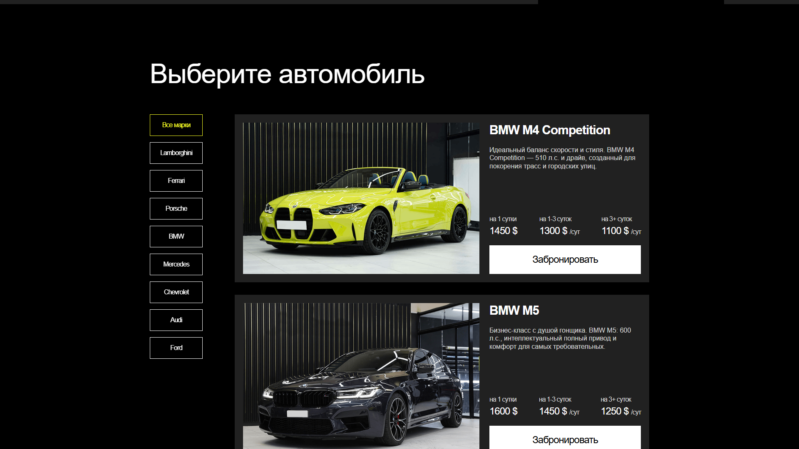
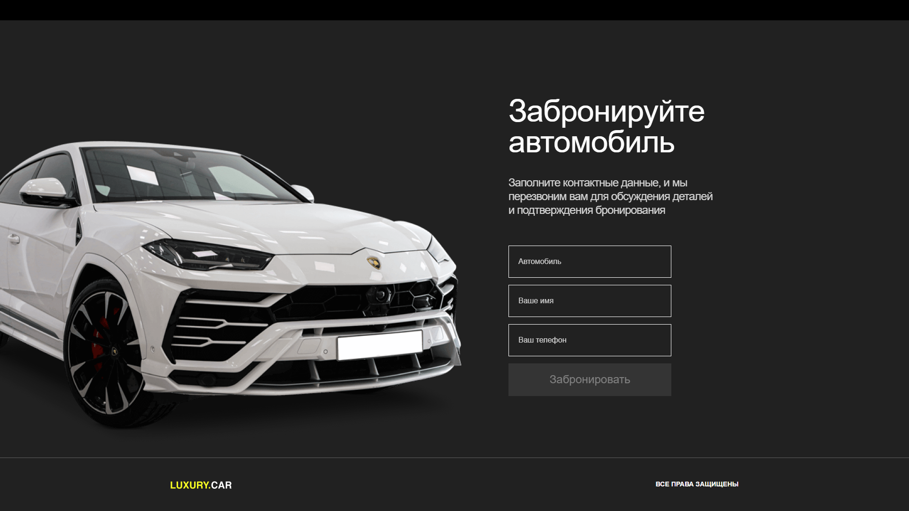
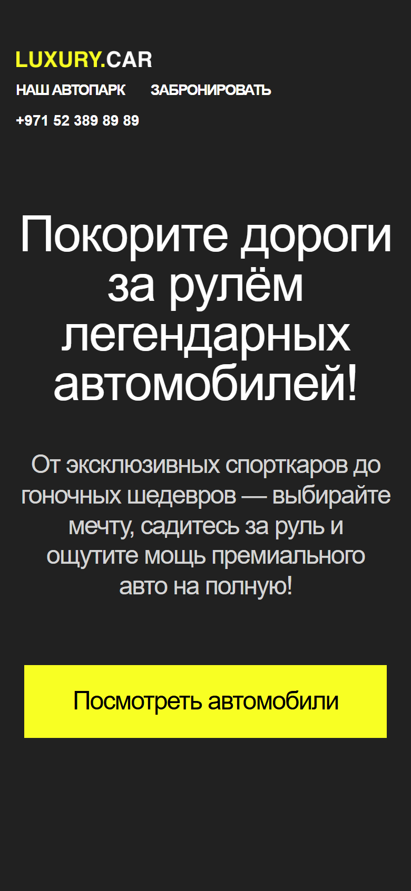

<p align="center">
  
</p>

<p align="center">
  <b>Лендинг проката спорткаров LUXURY.CAR на Angular: фильтр по маркам, данные с сервера и форма бронирования.</b>
</p>

<p align="center">
  
  
  
  <a href="https://dekciw.github.io/SuperCars/"></a>
</p>

<p align="center">
  <a href="https://dekciw.github.io/SuperCars/">
    
  </a>
</p>

<br>

<p align="center">
  
</p>

<br>

<table align="center">
  <tr>
    <th>&#8199;&#8199;&#8199;&#8199;&#8199;&#8199;Каталог&#8199;&#8199;&#8199;&#8199;&#8199;&#8199;</th>
    <th>&#8199;&#8199;&#8199;&#8199;&#8199;&#8199;Бронирование&#8199;&#8199;&#8199;&#8199;&#8199;&#8199;</th>
    <th>&#8199;&#8199;&#8199;&#8199;&#8199;&#8199;Интерфейс&#8199;&#8199;&#8199;&#8199;&#8199;&#8199;</th>
  </tr>
  <tr>
    <td valign="top">
      - Фильтр по 8 маркам<br>
      - Машины приходят с сервера<br>
      - Цена за 1, 1–3 и 3+ суток<br>
      - Фото и описание машины<br>
      - Кнопка «Забронировать»<br>
      - Кнопка «Все марки»
    </td>
    <td valign="top">
      - Машина, имя и телефон<br>
      - Angular Reactive Forms<br>
      - Без перезагрузки страницы<br>
      - Отправка на тестовый сервер<br>
      - Ответ сервера в сообщении<br>
      - Форма очищается сама
    </td>
    <td valign="top">
      - Машина едет при прокрутке<br>
      - Картинка следует за мышью<br>
      - Тёмная тема<br>
      - Адаптив до телефона<br>
      - Angular 19 и TypeScript<br>
      - Сайт на GitHub Pages
    </td>
  </tr>
</table>

<h3 align="center">Как это выглядит</h3>

<table align="center">
  <tr>
    <td width="50%" align="center" valign="top">
      <br>
      <sub>Каталог с фильтром по маркам</sub>
    </td>
    <td width="50%" align="center" valign="top">
      <br>
      <sub>Бронирование</sub>
    </td>
  </tr>
  <tr>
    <td colspan="2" align="center" valign="top">
      <br>
      <sub>Мобильная версия</sub>
    </td>
  </tr>
</table>

<br>

<details>
<summary><b>Подробнее о проекте: стек, устройство, запуск</b> (нажми, чтобы развернуть)</summary>

<br>

### Стек

<p>
- <b>Фреймворк:</b> Angular 19, standalone-компонент<br>
- <b>Язык:</b> TypeScript<br>
- <b>Формы:</b> Reactive Forms<br>
- <b>Данные:</b> HttpClient, учебный API <code>testologia.ru</code>
</p>

### Структура

```
.
├── src/
│   ├── main.ts                  # запуск приложения
│   ├── index.html
│   ├── global_styles.css        # общие стили
│   └── app/cars/                # вся страница: шаблон, стили и логика
├── public/images/               # логотип и фото машин
├── angular.json                 # настройки сборки
├── .github/workflows/pages.yml  # сборка и публикация на GitHub Pages
└── screenshots/                 # скриншоты для README
```

### Как это работает

<p>
- <b>Каталог</b> загружается запросом <code>cars-data</code>, при выборе марки приходит отфильтрованный список<br>
- <b>Бронирование</b> отправляет заявку запросом <code>cars-order</code> и показывает ответ сервера<br>
- <b>Анимации:</b> главная машина сдвигается при прокрутке, а машина у формы плавно следует за курсором
</p>

### Запуск

```bash
npm install
npx ng serve       # dev-сервер на http://localhost:4200
npm run build      # сборка в dist/demo/browser
```


</details>
